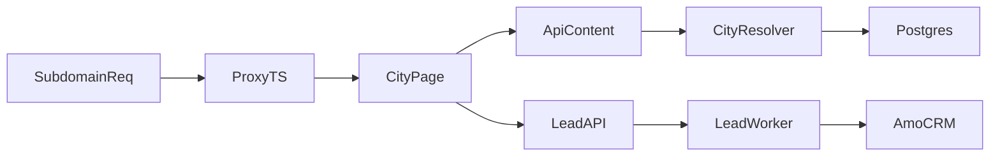

# Requirements

### Overview & Goals
Масштабировать текущий стек `blanq.tech` с одного региона (`tyumen`) до двух (`tyumen` + `ufa`) без поломки текущего flow лидов, улучшить региональное SEO и восстановить стабильную отправку лидов в `amoCRM`.

### Scope
#### In Scope
- Мультирегиональная модель данных: `cities` + привязка каталога/цен/филиалов к `city_id`.
- Автоопределение города на backend по `Host` и `X-City-Slug`.
- Маршрутизация Next.js под поддомены с внутренним rewrite на `app/[city]/...`.
- UI выбора города + сохранение `city_slug` в cookie.
- SEO по регионам: `sitemap`, `robots`, `canonical`, `hreflang`, JSON-LD `LocalBusiness`.
- Маркетинговая атрибуция: `utm_*`, `yclid`, `_ym_uid`, мультилендинг-заголовки.
- Рефакторинг `amoCRM` интеграции с устойчивым OAuth refresh и передачей city/utm/`_ym_uid` в сделку.

#### Out of Scope
- Полный редизайн лендинга.
- Изменение внешнего API amoCRM (используется текущий REST v4).
- Миграция на другой стек хранения токенов (фиксируем PostgreSQL).

### Key Functional Requirements
1. `cities` хранит: `id`, `slug`, `name`, `name_prepositional`, `timezone`, `phone`, `email`, `is_active`.
2. One-to-many связи: `City -> Service`, `City -> AddonService (pricing)`, `City -> Branch`.
3. Backend city-resolver приоритет: `Host subdomain -> X-City-Slug -> default tyumen`.
4. Городо-зависимый endpoint `/api/v1/content` возвращает только контент/цены выбранного города.
5. Для Next.js 16 используется `proxy.ts` (а не deprecated `middleware.ts`) для subdomain rewrite.
6. SEO-метаданные и schema-разметка должны различаться по региону (контакты/телефон/город/каноникал).
7. UTM и `yclid` сохраняются и участвуют в персонализации H1 (мультилендинг) и в лиде.
8. `amoCRM` lead payload включает кастомные поля: `Город`, `UTM source/medium/campaign`, `_ym_uid`.

### Non-Functional Requirements
- Типизация: `TypeScript` strict + `Pydantic v2` модели.
- Надёжность: лид сохраняется в БД до внешних вызовов; ошибки интеграции не теряют данные.
- SEO-безопасность: исключение дублей между регионами через корректные `canonical/hreflang`.

# Technical Design

### Current Implementation
- Backend уже мультирегионален частично:
  - `services/api/app/models/catalog.py`: `City`, `Service`, `AddonService`, `Master` уже связаны через `city_id`.
  - `services/api/app/repositories/catalog.py`: выборка города/услуг/доп.услуг по `slug` и `city_id`.
  - `services/api/app/api/v1/pricing.py`, `booking.py`, `leads.py`, `content.py`: город обычно передаётся явно как `city_slug`.
- Frontend сейчас монорегиональный (Тюмень):
  - `apps/web/app/layout.tsx`, `apps/web/app/page.tsx`: статичные title/description/schema под Тюмень.
  - `apps/web/app/sitemap.ts`, `apps/web/app/robots.ts`: статичный single-domain SEO.
  - `apps/web/lib/api.ts`: по умолчанию `city_slug = "tyumen"`.
- amoCRM:
  - OAuth в `services/api/app/services/amocrm_oauth.py`, хранение токенов в `amocrm_tokens` (`models/integrations.py`).
  - Отправка лида через `services/api/app/services/leads.py` + `services/api/app/services/amocrm.py`.

### Key Decisions
1. **City resolution**: `Host -> X-City-Slug -> tyumen`.
2. **Next.js routing**: использовать `proxy.ts` + internal rewrite на `app/[city]/...` (по гайду Next.js 16 `middleware -> proxy`).
3. **Token storage**: OAuth токены amoCRM оставляем в `PostgreSQL` как source of truth (без Redis-only схемы).
4. **SEO generation**: региональная SEO-логика выносится в city-aware серверные генераторы метаданных/маршрутов.

### Proposed Changes
#### 1) Data layer (DB + models + seed)
- Обновить `City` в `services/api/app/models/catalog.py`: добавить `name_prepositional`, `phone`, `email`.
- Добавить модель филиалов (`Branch`) с `city_id` (one-to-many), включить в `models/__init__.py`.
- Выпустить миграцию после `0003_auth.py` для:
  - новых колонок `cities`;
  - таблицы `branches`;
  - индексов/ограничений (`slug` unique, `city_id` index).
- Обновить сидирование (`services/api/app/seed.py`) для двух городов: `tyumen`, `ufa`, и их каталога/цен/филиалов.

#### 2) Backend city context + `/api/v1/content`
- Добавить city resolver dependency (например, `services/api/app/api/city_context.py`):
  - парсинг subdomain из `Host` (`ufa.blanq.tech` → `ufa`, apex → `tyumen`);
  - fallback на `X-City-Slug`;
  - fallback на default slug.
- Расширить/добавить endpoint `GET /api/v1/content` в `services/api/app/api/v1/content.py`:
  - возвращать региональные блоки, контакты, цены и SEO-поля только выбранного города;
  - использовать репозитории каталога/филиалов.

#### 3) Frontend multiregion routing + city selector
- Добавить `apps/web/proxy.ts` (Next.js 16) вместо `middleware.ts`:
  - матчинг публичных страниц;
  - rewrite `host -> /[city]` с сохранением URL в браузере.
- Добавить `apps/web/app/[city]/page.tsx` и выделить общий лендинг shell из текущего `app/page.tsx`.
- Ввести city context/cookie utilities (`apps/web/lib/city.ts`) и UI выбора города (модалка в `components/`).
- Обновить `apps/web/lib/api.ts` и формы (`CallbackModal.jsx`, `CleaningCalculator.jsx`) для подстановки текущего `city_slug`.

#### 4) Regional SEO
- Сделать city-aware `generateMetadata` в сегменте `app/[city]/...`:
  - `canonical` на текущий регион;
  - `hreflang` между регионами.
- Перевести `robots`/`sitemap` на региональную генерацию (host/city-aware output).
- В `app/[city]/page.tsx` генерировать JSON-LD `LocalBusiness` с динамическими `city`, `phone`, `address`.

#### 5) Marketing & Yandex
- Добавить frontend hook для парсинга и сохранения `utm_*`, `yclid`, `_ym_uid` (cookie/localStorage).
- Реализовать мультилендинг: map `utm_campaign -> H1` (например, `уборка_после_ремонта`).
- Добавить инициализацию Яндекс.Метрики и утилиту целей (`Lead`, `Call`, `FormSubmit`) в `apps/web/lib/analytics` слое.

#### 6) amoCRM hardening
- Усилить OAuth refresh flow в `amocrm_oauth.py` и repository-операции `amocrm.py` (безопасная ротация, обработка ошибок/просрочки).
- Расширить lead DTO/модель:
  - `services/api/app/schemas/leads.py` и `models/orders.py` (`Lead`) для `_ym_uid` и структурированных UTM.
- В `services/api/app/services/amocrm.py` обновить `build_complex_lead_payload`:
  - добавить кастомные поля сделки: `Город`, `UTM source/medium/campaign`, `_ym_uid`.
- Обновить путь передачи данных: frontend -> `/leads` -> фоновые задачи -> amoCRM.

### Data Contracts (planned)
- `City`: `slug`, `name`, `name_prepositional`, `timezone`, `phone`, `email`, `is_active`.
- `LeadCreate` (API): `name`, `phone`, `city_slug`, `source`, `context`, `utm`, `ym_uid`.
- `/api/v1/content` response: city profile + pricing blocks + branch contacts + SEO payload.

### Architecture Diagram

### File Structure (planned)
- **Backend**
  - `services/api/app/models/catalog.py` (City + relations)
  - `services/api/app/models/branches.py` *(new, if split)* or branch model in `catalog.py`
  - `services/api/app/repositories/catalog.py` (city-aware fetches)
  - `services/api/app/repositories/leads.py` (new lead fields)
  - `services/api/app/api/city_context.py` *(new)*
  - `services/api/app/api/v1/content.py`
  - `services/api/app/services/amocrm.py`
  - `services/api/app/services/amocrm_oauth.py`
  - `services/api/app/seed.py`
  - `services/api/alembic/versions/0004_multiregion_marketing_amocrm.py` *(new)*
- **Frontend**
  - `apps/web/proxy.ts` *(new)*
  - `apps/web/app/[city]/page.tsx` *(new)*
  - `apps/web/app/[city]/layout.tsx` *(optional new for metadata scope)*
  - `apps/web/components/CitySelectorModal.tsx` *(new)*
  - `apps/web/lib/city.ts` *(new)*
  - `apps/web/lib/api.ts`
  - `apps/web/lib/analytics.js` (+ metrika helpers)
  - `apps/web/app/sitemap.ts` / `robots.ts` (или host-aware route equivalents)

### Risks & Mitigations
- **Risk**: дубль-контент между регионами.
  - **Mitigation**: строгие `canonical/hreflang`, региональный `sitemap`.
- **Risk**: неверное определение города на localhost/dev.
  - **Mitigation**: явные dev-правила и fallback на `X-City-Slug`.
- **Risk**: amoCRM custom fields отличаются между аккаунтами.
  - **Mitigation**: field IDs в env/config, валидируем наличие при старте интеграции.

# Testing

### Validation Approach
- Использовать текущий backend test stack (`pytest`, `fastapi.testclient`) и локальные проверки frontend сборки (`next build`/lint).
- Проверять не только happy-path, но и деградацию: fallback city, отключённая CRM, невалидные UTM.

### Key Scenarios
1. `Host=ufa.blanq.tech` -> API резолвит `ufa`, `/api/v1/content` и цены возвращают только Ufa-данные.
2. Без subdomain + `X-City-Slug=tyumen` -> корректный fallback.
3. `proxy.ts` делает rewrite на `app/[city]` без изменения адреса в браузере.
4. City selector сохраняет cookie и последующие запросы/формы отправляют правильный `city_slug`.
5. SEO:
   - `canonical` соответствует текущему региону;
   - `hreflang` указывает альтернативный регион;
   - JSON-LD содержит региональные телефон/адрес.
6. UTM/Yclid/_ym_uid парсятся, сохраняются и уходят в `POST /api/v1/leads`.
7. Лид доходит до amoCRM с полями `Город`, `UTM`, `_ym_uid`; при сбое CRM лид остаётся в БД и уходит в retry.

### Edge Cases
- Неизвестный поддомен (`foo.blanq.tech`) -> безопасный fallback (`tyumen` или 404 по политике).
- Город неактивен (`is_active=false`) -> исключается из каталога и SEO.
- Просроченный refresh token -> controlled error + лог + повтор без потери лида.
- Пустые UTM/yclid -> payload остаётся валидным, без падений сериализации.

# Delivery Steps

### ✓ Step 1: Extend regional data model and seed Tyumen/Ufa
Database schema supports two active cities with region-specific contacts, catalog pricing, and branches.
- Add migration `0004_multiregion_marketing_amocrm.py` to extend `cities` (`name_prepositional`, `phone`, `email`) and create `branches` linked by `city_id`.
- Update ORM models in `services/api/app/models/catalog.py` (and `models/__init__.py`) with one-to-many relations: `City -> Service`, `City -> AddonService`, `City -> Branch`.
- Update `services/api/app/seed.py` to insert full seed set for `tyumen` and `ufa` (cities, services/addons with prices, branches).
- Keep compatibility with existing pricing logic (`services`/`addon_services` as city-bound price catalogs).

### ✓ Step 2: Implement backend city resolver and city-scoped content API
Backend determines city automatically per request and serves city-specific `/api/v1/content` payload.
- Introduce city context resolver dependency (new module under `services/api/app/api/`) with priority `Host -> X-City-Slug -> tyumen`.
- Integrate resolver into `services/api/app/api/v1/content.py` and related query logic in repositories.
- Add/reshape `GET /api/v1/content` contract to return city profile, pricing blocks, and branch/contact data strictly for resolved city.
- Update Pydantic schemas for explicit typed response fields and 404/validation behavior for unknown city slugs.

### ✓ Step 3: Implement Next.js 16 regional routing and city selection UX
Subdomains are internally routed to dynamic city pages while users keep clean regional URLs.
- Add `apps/web/proxy.ts` (Next.js 16 convention) to map host/subdomain to internal `app/[city]` routes; avoid deprecated `middleware.ts` as primary path.
- Add `apps/web/app/[city]/page.tsx` and extract shared landing composition from current `app/page.tsx`.
- Implement city selector modal component with cookie persistence (`city_slug`) and connect it in top-level layout/app shell.
- Update frontend API calls (`apps/web/lib/api.ts`, forms/components) to consistently send resolved/selected `city_slug`.

### ✓ Step 4: Roll out regional SEO metadata and structured data
Each city variant has distinct indexation signals, canonicalization, and structured local business data.
- Refactor metadata generation in city route segment (`generateMetadata`) to emit region-specific `title/description/canonical/hreflang`.
- Convert `sitemap` and `robots` generation to city-aware output for subdomain strategy.
- Generate JSON-LD `LocalBusiness` dynamically in city pages using branch address, phone, and city labels.
- Ensure regional pages avoid duplicate-content conflicts and preserve discoverability for paid/organic traffic.

### ✓ Step 5: Add Yandex Direct attribution, multilanding logic, and Metrica goals
Frontend captures traffic attribution and uses it in both UX personalization and analytics events.
- Implement reusable attribution hook/util to parse and persist `utm_*`, `yclid`, and `_ym_uid`.
- Add campaign-to-H1 personalization map (e.g., `utm_campaign=уборка_после_ремонта`) in city landing rendering flow.
- Extend analytics layer with Yandex.Metrica initialization and goal helpers (`Lead`, `Call`, `FormSubmit`).
- Wire attribution payload into lead submission from callback/calculator flows.

### ✓ Step 6: Harden amoCRM delivery with PostgreSQL token lifecycle and custom lead fields
Lead sync to amoCRM becomes resilient and includes regional + marketing analytics fields required for end-to-end attribution.
- Strengthen OAuth refresh logic in `services/api/app/services/amocrm_oauth.py` and token repository flow for PostgreSQL-backed rotation.
- Extend lead DTO/model/repository (`schemas/leads.py`, `models/orders.py`, `repositories/leads.py`) to store and forward `_ym_uid` and normalized UTM structure.
- Update `build_complex_lead_payload` in `services/api/app/services/amocrm.py` to include custom fields: city, UTM source/medium/campaign, `_ym_uid`.
- Verify background dispatch (`services/api/app/services/leads.py`) preserves guaranteed local save + retry semantics when amoCRM is unavailable.