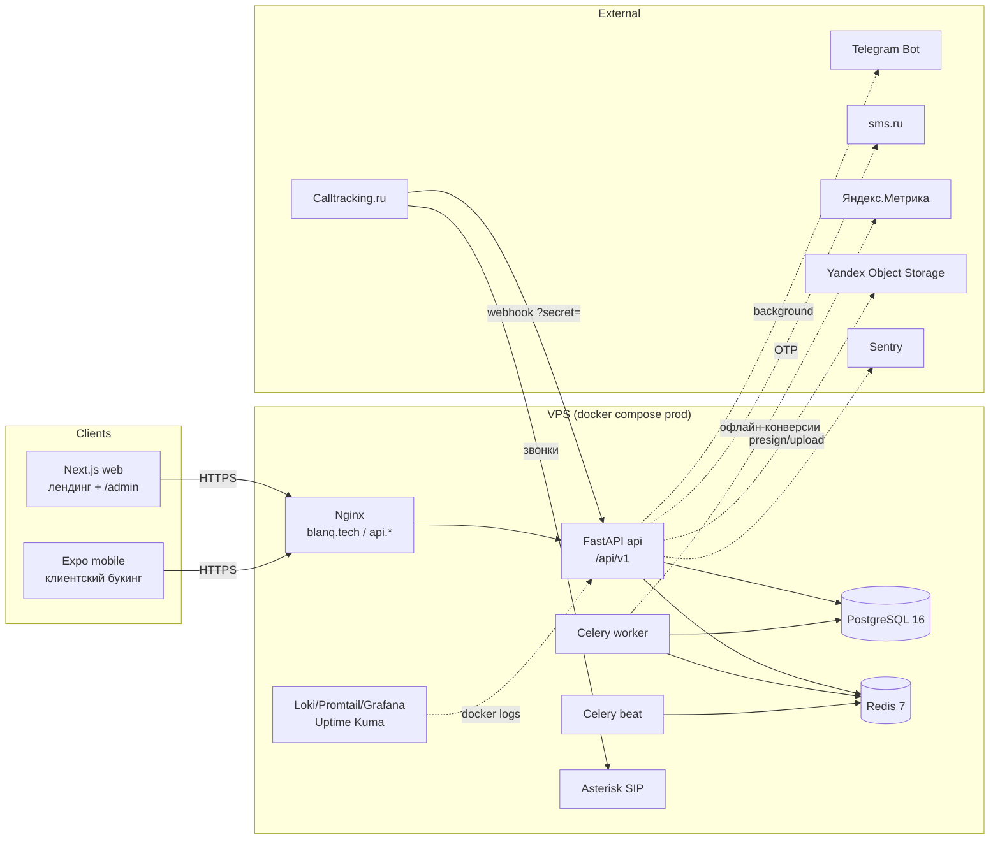
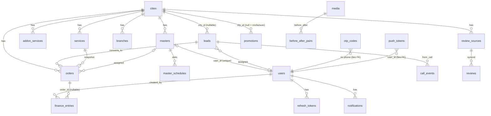
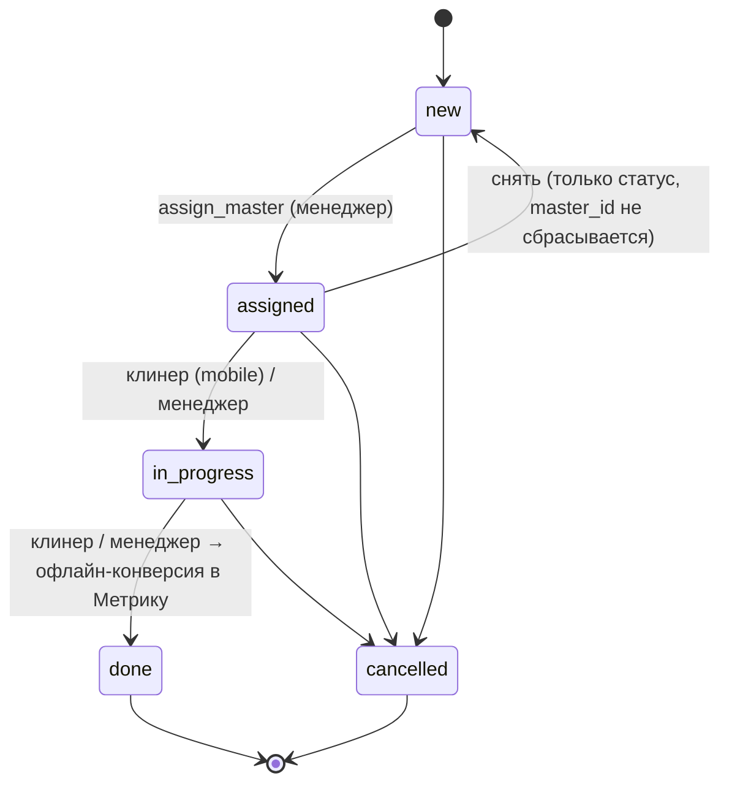
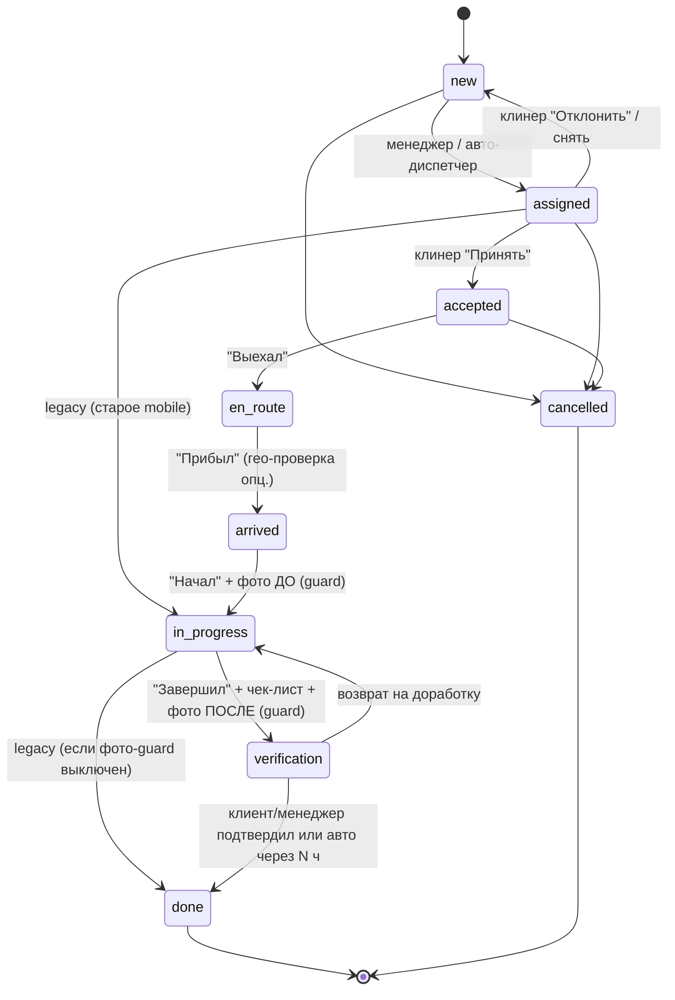

# Системный аудит платформы «Точка Чистоты» — Stage 1

| | |
|---|---|
| **Репозиторий** | `github.com/Blanq-Tech/clean-comp`, ветка `main`, ревизия `a1852ed` |
| **Дата аудита** | 2026-09-11 |
| **Цель** | Оценить готовность кодовой базы к расширению в кросс-платформенную мобильную систему с раздельными потоками **Клиент** и **Клинер (мастер)** и зафиксировать стратегию рефакторинга без поломки работающего лендинга, CRM и деплоя |
| **Метод** | Полное чтение исходников (backend, web, mobile, deploy, CI), запуск существующих проверок (pytest, tsc, eslint) на текущей ревизии |

> Код в Stage 1 **не изменялся**. Документ — основание для решений перед Stage 2.

---

## 0. Резюме

**Что есть.** Работающая продакшен-платформа лендинга + собственной CRM: FastAPI-бэкенд (async SQLAlchemy 2.0, PostgreSQL 16, Redis 7, Celery), Next.js 16 лендинг с мультирегиональным SEO (Тюмень/Уфа) и админ-панелью `/admin`, зачаточное Expo-приложение (только клиентский букинг), Docker/GHCR/GitHub Actions авто-деплой, стек наблюдаемости (Loki/Grafana/Uptime Kuma/Sentry). Есть многоролевая аутентификация (client / master / manager / admin), чистая и покрытая тестами функция ценообразования, машина статусов заказа с валидацией переходов, идемпотентные сиды и миграции Alembic (9 ревизий, 20 таблиц).

**Чего нет для целевого MVP.** Адреса и геолокация (в заказе вообще нет адреса), real-time (ни WebSocket, ни SSE, ни доставки push), оплаты, чек-листы, фото по заказу (медиа-инфраструктура есть, но только для маркетинговых кейсов «До/После» и только для админа), чаевые/оценки по заказу, финансы клинера, подписки, capacity-based доступность (слоты сейчас пред-засеяны по мастерам на 5 дней), поток клинера в мобильном приложении (mobile использует лишь публичные эндпоинты и не трогает `/mobile/*`).

**Оценка готовности к целевому продукту (по функциональным областям):**

| Область | Готовность | Комментарий |
|---|---|---|
| Аутентификация и роли | ~70% | OTP/пароль/JWT/refresh есть; нужны rate-limit, разделение секретов, гейт роли `master`, reuse-detection refresh |
| Ценообразование | ~60% | Формула и тесты есть; нет типа «Мытьё окон» как услуги, скидок подписки, `updated_at`/версионирования тарифов |
| Заказы / статусы | ~35% | 5 статусов, нет `en_route/arrived/verification`, истории статусов, адреса, привязки к учётке клиента |
| Букинг / доступность | ~30% | Фиксированные слоты без учёта загрузки; гонка при бронировании; нет транзакции |
| Real-time / push | ~5% | Только регистрация push-токенов; отправки нет |
| Фото / чек-листы | ~10% | S3 presign есть (admin only); нет фото по заказу и чек-листов |
| Оплаты / чаевые | 0% | Ручной финансовый журнал компании |
| Отзывы и рейтинг по заказу | ~10% | Только маркетинговые отзывы; рейтинг мастера — статичное число |
| Финансы клинера | ~5% | `finance_entries` без `master_id`; нет баланса/выплат |
| Подписки | 0% | — |
| Админ-CRM (web) | ~60% | Лиды, канбан, мастера, RBAC, финансы; сессия живёт 15 мин (нет refresh), нет истории заказа |
| Mobile: клиент | ~25% | OTP + расчёт + слот + бронь, без города/адреса/истории заказов |
| Mobile: клинер | 0% | — |
| Инфраструктура / деплой / observability | ~75% | CI без тестов; нет WS-конфигурации nginx |

**Ключевые решения, которые нужно принять до Stage 2** — см. раздел 9.

---

## 1. Инвентаризация репозитория

### 1.1 Структура монорепо

```
clean-comp/
├── apps/
│   ├── web/                 # Next.js 16 (App Router): лендинг, SEO-посадочные, /admin CRM
│   │   ├── app/             # layout, page, [city]/, [city]/[service]/, admin/*, spasibo, oferta, privacy
│   │   ├── components/      # Quiz, CallbackModal, Cases, Reviews, Team, admin/*, ...
│   │   ├── lib/             # api.ts (публичный клиент), admin.ts (CRM-клиент), city.ts, seo.ts, attribution.ts
│   │   ├── proxy.ts         # Next 16 proxy (замена middleware): host/cookie → /[city]
│   │   └── Dockerfile       # standalone-сборка (контекст = корень монорепо)
│   └── mobile/              # Expo SDK 51 + expo-router (клиентский букинг, 1.1k строк)
│       ├── app/             # (auth)/login, (tabs)/index (заявка), (tabs)/profile
│       └── src/             # api/client.ts (+refresh), api/types.ts, auth/AuthContext.tsx
├── services/api/            # FastAPI backend (~7.1k строк app + 0.9k миграций + 1k тестов)
│   ├── app/
│   │   ├── core/            # config, db, redis, celery_app, s3, security, logging, sentry
│   │   ├── api/             # deps, auth_deps (RBAC), city_context, middleware (metrics), v1/* роутеры
│   │   ├── models/          # 20 ORM-таблиц
│   │   ├── schemas/         # Pydantic v2 DTO
│   │   ├── repositories/    # SQL-доступ (SQLAlchemy async)
│   │   ├── services/        # бизнес-логика: pricing, quoting, orders, booking, auth, calltracking, ...
│   │   ├── tasks/           # Celery: analytics (офлайн-конверсии), reviews (sync), media (noop), runner
│   │   └── seed.py          # идемпотентные сиды (Тюмень + Уфа)
│   ├── alembic/versions/    # 0001 … 0009
│   └── tests/               # 15 файлов, 60 тестов
├── deploy/                  # compose (dev/prod/monitoring/sip/mail), nginx, remote-deploy.sh, healthcheck.sh
├── .github/workflows/       # build-and-push.yml: сборка образов → GHCR → SSH-деплой (только main)
├── package.json             # npm workspaces (apps/web); mobile ставится отдельно
└── Makefile                 # обёртки над docker compose
```

Учтённых git-файлов: **269**, коммитов: **50**, автор один. Стары́й worktree `.claude/worktrees/wizardly-kepler-c57b4f` (ревизия `9e3ef83`) не влияет на код, но индексируется инструментами — кандидат на удаление.

### 1.2 Технологический стек (фактические версии)

| Слой | Технологии | Версии (установлено) |
|---|---|---|
| Web | Next.js App Router, React, Tailwind CSS, framer-motion, lucide-react, TypeScript (+ часть компонентов на `.jsx`) | next 16.2.7, react 19.2.4, tailwind 4, TS 5, Node 24.15 |
| Mobile | Expo, expo-router, expo-secure-store, React Native, TypeScript strict | expo 51.0.39, RN 0.74.5, expo-router 3.5, TS 5.3 |
| Backend | Python, FastAPI, SQLAlchemy async + asyncpg, Pydantic v2 + pydantic-settings, Alembic, Celery, redis-py, httpx, loguru, boto3, pyjwt + bcrypt, sentry-sdk | Dockerfile `python:3.12-slim`; локально venv 3.13.13; fastapi 0.138.0, sqlalchemy 2.0.51, pydantic 2.13.4 |
| Данные | PostgreSQL 16 (alpine), Redis 7 (AOF в prod) | — |
| Инфра | Docker Compose, Nginx (системный), GitHub Actions → GHCR, Loki + Promtail + Grafana + Uptime Kuma, Asterisk (SIP для Calltracking), docker-mailserver + Roundcube | — |
| Интеграции | Telegram Bot (пинг о лиде), sms.ru (OTP), Calltracking.ru (вебхук звонков + подмена номеров), Яндекс.Метрика (цели + офлайн-конверсии), Yandex Object Storage (S3), Sentry | все с mock-режимом при пустых ключах |

Зависимость `amocrm-api` в `pyproject.toml`/`requirements.txt` **не используется** (интеграция удалена миграцией 0008), но по-прежнему ставится в образ.

### 1.3 Конфигурация и окружения

**Backend (`Settings`, `services/api/app/core/config.py`, читает `.env`/env):**
`ENVIRONMENT`, `DEBUG`, `DATABASE_URL`, `REDIS_URL`, `CELERY_BROKER_URL`, `CELERY_RESULT_BACKEND`, `CORS_ORIGINS`, `CALLTRACKING_WEBHOOK_SECRET`, `CALLTRACKING_CITY_NUMBERS`, `YANDEX_METRIKA_TOKEN`, `YANDEX_METRIKA_COUNTER_ID`, `YANDEX_METRIKA_GOAL_DONE`, `S3_*` (7 переменных), `SMS_ENABLED`, `SMS_RU_API_ID`, `TELEGRAM_ENABLED`, `TELEGRAM_BOT_TOKEN`, `TELEGRAM_CHAT_ID`, `JWT_SECRET` (дефолт `change-me-in-production`), `JWT_ALGORITHM`, `JWT_ACCESS_TTL_MINUTES`=15, `JWT_REFRESH_TTL_DAYS`=30, `SENTRY_DSN`, `LOG_LEVEL`, `LOG_JSON`. Неизвестные переменные игнорируются (`extra="ignore"`), поэтому `AMOCRM_*` из compose молча отбрасываются.

**Web:** `NEXT_PUBLIC_SITE_URL`, `NEXT_PUBLIC_API_URL`, `NEXT_PUBLIC_CALLTRACKING_SCRIPT_URL`, `NEXT_PUBLIC_YANDEX_METRICA_ID` (инлайнятся в бандл на этапе сборки в CI).

**Mobile:** `EXPO_PUBLIC_API_URL`, `EXPO_PUBLIC_DEFAULT_CITY` (дефолт `tyumen`).

**Compose-файлы:** `docker-compose.yml` (dev: web+api+worker+beat+postgres+redis, порты наружу), `docker-compose.dev.yml` (hot-reload), `docker-compose.prod.yml` (образы из GHCR, порты только на 127.0.0.1, ротация логов 50m×3, обязательные `JWT_SECRET`/`POSTGRES_PASSWORD`), `docker-compose.monitoring.yml`, `docker-compose.sip.yml` (host network), `docker-compose.mail.yml`.

**Секреты:** `deploy/.env` и `apps/mobile/.env` в `.gitignore` и не отслеживаются (проверено). В отслеживаемых файлах жёстко прописанных ключей не найдено. `deploy/mail/mailserver.env` отслеживается, но секретов не содержит.

### 1.4 Метрики кодовой базы

| Область | Строк | Файлов |
|---|---|---|
| Backend (`services/api`, .py) | 8 992 (в т.ч. тесты ≈ 970, миграции ≈ 900, seed 642) | 109 |
| Web (`apps/web`) | 7 303 | 62 |
| Mobile (`apps/mobile`) | 1 148 | 17 |
| Deploy/CI (yml, sh, conf, md) | 1 645 | 24 |

Самые крупные единицы: `api/v1/admin.py` (507), `seed.py` (642), `admin/leads/page.tsx` (506), `QuizCalculator.jsx` (506).

### 1.5 Состояние проверок на текущей ревизии (запущено в ходе аудита)

| Проверка | Результат | Детали |
|---|---|---|
| `pytest` (backend) | **53 passed, 7 skipped** | Пропущены интеграционные тесты (`test_content_api`, `test_integration_lead_flow`, `test_seed_multiregion`) — нужен живой PostgreSQL; Docker-демон локально не запущен. Предупреждения: HMAC-ключ JWT короче 32 байт при дефолтном секрете; deprecation `starlette.testclient`+httpx |
| `tsc --noEmit` (web) | **OK** | — |
| `eslint` (web) | **FAIL: 6 ошибок, 1 предупреждение** | `react-hooks/set-state-in-effect` в 5 админ-страницах (`admin/page.tsx:113`, `leads:228`, `masters:33`, `users:31`, `finance:43`) и `CalltrackingScript.jsx:30`; `no-img-element` в `YandexMetrika.jsx:41`. Next 16 не запускает ESLint при `next build`, поэтому CI-сборка проходит, но `npm run lint` красный |
| `tsc --noEmit` (mobile) | **OK** | — |
| CI (`build-and-push.yml`) | Сборка образов + деплой | **Тесты, lint и tsc в CI не запускаются вообще** |

> Обновление 2026-09-11 (после Phase 0, раздел 8): ESLint чист, `alembic check` чист, CI гоняет ruff/pytest
> (с PostgreSQL)/tsc/eslint перед сборкой образов; локально с БД — 113 тестов, 0 пропущенных.

---

## 2. Текущая архитектура

### 2.1 Обзор компонентов



### 2.2 Backend: слои и модули

Архитектура **слоистая по техническому признаку** (не по доменам):

| Слой | Файлы | Назначение |
|---|---|---|
| `api/v1/*` | `router.py`, `health`, `auth`, `mobile`, `admin`, `pricing`, `leads`, `booking`, `reviews`, `content`, `integrations` | тонкие роутеры; ловят доменные исключения и превращают в `HTTPException` |
| `api/*` | `auth_deps.py` (`get_current_user`, `require_roles`), `city_context.py` (Host → X-City-Slug → tyumen), `middleware.py` (request-id, тайминг, in-process метрики) | cross-cutting |
| `services/*` | `pricing.py` (чистая формула), `quoting.py` (оркестрация над БД), `orders.py` (машина статусов, уведомления, конверсии), `booking.py`, `auth.py`, `calltracking.py`, `telegram.py`, `sms.py`, `media.py`, `yandex_offline.py`, `reviews_sync.py` (мок), `phones.py` | бизнес-логика |
| `repositories/*` | `catalog`, `orders`, `leads`, `users`, `masters`, `booking`, `finance`, `media`, `notifications`, `reviews` | SQL; каждый метод сам делает `commit()` |
| `models/*` | 20 таблиц (см. 2.3) | ORM, `UUIDPrimaryKeyMixin` + `TimestampMixin` (`created_at` только) |
| `tasks/*` | `analytics.upload_offline_conversion` (retry ×3), `reviews.sync_reviews` (beat, 1 ч), `media.process_media` (noop) | Celery |
| `core/*` | settings, engine/session, redis, celery, s3 (boto3), security (bcrypt/JWT/HMAC), loguru JSON, sentry | инфраструктура |

Особенности: нет глобальных exception handlers (единого формата ошибок); нет rate limiting; нет `updated_at` ни в одной таблице; коммиты в репозиториях (нет unit-of-work → многошаговые операции не атомарны); `BaseHTTPMiddleware` для метрик (известное ограничение для стриминга — важно для будущего SSE).

### 2.3 Модель данных (Alembic head `0009_fix_call_events`, 20 таблиц)



Ключевые сущности:

| Таблица | Назначение | Замечания |
|---|---|---|
| `cities` | регион: slug, тарифный `price_multiplier`, телефон, email, `name_prepositional`, timezone | активные: `tyumen`, `ufa` |
| `services` | тариф услуги по городу: `type` (`maintenance`/`general`/`post_renovation`/`office`), `base_price`, `price_per_room`, `price_per_bathroom`, `price_per_sqm`, минуты | unique `(city_id, type)` |
| `addon_services` | доп.услуги с `unit`/`max_qty` (окна за створку, глажка за час и т.д.) | unique `(city_id, code)` |
| `masters` | клинер: город, ФИО, `rating` (статичный Numeric), `phone`, `user_id` → users | рейтинг никем не пересчитывается |
| `master_schedules` | слот `work_date + start_time + end_time + is_booked` | сид создаёт 2 слота/день на 5 дней вперёд |
| `leads` | заявка (сайт/квиз/звонок/букинг): контакт, `context`, `price`, `service_type`, UTM/`yclid`/`gclid`/`ym_uid`, воронка `new→in_progress→converted/rejected`, `assignee_id`, `manager_note` | телефон **не нормализуется** при создании с сайта/букинга |
| `orders` | снимок расчёта: `lead_id`, `city_id`, `service_id`, `master_id`, `rooms`, `bathrooms`, `addons` (JSONB), `total_price`, `est_minutes`, `discount_code`, `status`, `scheduled_at` | **нет адреса, нет привязки к `users`, нет `updated_at`, нет истории статусов** |
| `promotions` | промокод percent/fixed, `valid_until`, город или глобально | — |
| `media`, `before_after_pairs` | файлы S3 (`owner_type`/`owner_id` без FK) и маркетинговые кейсы с карточкой заказа | сиды хранят `bucket='seed'` с локальными `/cases/*.webp` |
| `review_sources`, `reviews` | внешние/ручные отзывы для сайта (провайдер, `source_url`, `service_type`) | коннекторы Яндекс/2ГИС — заглушки |
| `users`, `otp_codes`, `refresh_tokens` | единая учётка: `phone` unique, `email`, `password_hash`, `role`, `is_active`; OTP — только хеш; refresh — только хеш, ротация | — |
| `push_tokens` | Expo-токены устройств | `user_id` без FK |
| `notifications` | in-app история уведомлений (`kind`, `data`, `is_read`, `sent_at`) | `sent_at` никогда не выставляется — push не отправляется |
| `finance_entries` | ручной журнал доходов/расходов компании (город, заказ, категория) | нет `master_id` |
| `call_events` | события Calltracking (идемпотентно по `external_id`), привязка к лиду | — |

Дрейф ORM ↔ миграции (не ломает работу, но `alembic autogenerate` покажет диффы): `services.price_per_room/price_per_bathroom`, `orders.rooms/bathrooms/est_minutes`, `cities.timezone`, `otp_codes.purpose`, `leads.source` — в миграциях `nullable=True`, в ORM `Mapped[...]` без `Optional` (NOT NULL). Проверки `alembic check` в CI нет.

### 2.4 Бизнес-логика

**Ценообразование** (`services/pricing.py::compute_quote`, чистая функция, Decimal, 10 тестов):

```
base   = base_price + rooms·price_per_room + bathrooms·price_per_bathroom
       + area_sqm·price_per_sqm (только если тариф «от м²» > 0)
       + Σ addon.price·qty (qty ограничен addon.max_qty)
base  ×= condition_coeff   # normal 1.00 | neglected 1.15 | heavy 1.30 | needs_assessment 1.00 + флаг
subtotal = base × city.price_multiplier
total    = subtotal − promo (percent | fixed, не больше subtotal)
minutes  = (minutes_base + Σ per_room/bathroom + 0.5·area + Σ addon.minutes·qty) × condition_coeff
```

`quoting.build_quote` достаёт город/услугу/допы/промокод из БД. Один и тот же расчёт используют `POST /pricing/quote`, `POST /booking/bookings` и конверсия лида в заказ из CRM. Квиз на сайте (после ТЗ п.14) **цену не показывает** и отправляет только лид.

**Воронка лидов и CRM:** `POST /leads` → запись `leads(status=new)` (синхронно) → `BackgroundTasks` Telegram-пинг операторам. Менеджер в `/admin/leads` ведёт статус/ответственного/заметку и конвертирует лид в заказ (`POST /admin/leads/{id}/convert` → `build_quote` без промокода → `orders`, лид → `converted`). Звонки Calltracking → `call_events` + автолид (дедуп 30 мин по номеру).

**Букинг:** `POST /booking/bookings` → расчёт → проверка слота (свободен, город совпадает) → `leads(source=booking)` → `orders(status=new | assigned при слоте, scheduled_at в TZ города)` → `master_schedules.is_booked=true` → Telegram. Каждый шаг — отдельный `commit()`; блокировок нет.

**Машина статусов заказа** (`models/orders.py::ORDER_TRANSITIONS`, `services/orders.py::change_status`):



Роли: клинер из мобайла может перевести **только свой** заказ и только в `in_progress`/`done`; staff — любой допустимый переход. Смена статуса создаёт `notifications` клиенту (если есть `users` с телефоном лида) и клинеру при назначении.

**Аутентификация:** OTP 4 цифры, TTL 5 мин, 5 попыток, хранится HMAC-SHA256(`jwt_secret`); роль `client|master` присваивается при первом входе по параметру запроса; staff — bcrypt-пароль по телефону/email; access JWT HS256 15 мин; refresh 30 дней, ротация и отзыв; при OTP-входе мастера учётка связывается с карточкой `masters` по телефону.

**Определение города:** backend — `Host` (`*.cleanliness.pro`, `*.localhost`) → `X-City-Slug` → `tyumen`; web `proxy.ts` — path → host → header → cookie → **`ufa`**. Дефолты расходятся (см. 4.6).

### 2.5 Frontend web

- Лендинг `App.jsx` (client component) с секциями; квиз (4 шага: объект → площадь → тип уборки → контакты) и модалка обратного звонка шлют `POST /leads` с атрибуцией (UTM/yclid/gclid/ym_uid из `lib/attribution.ts`), после отправки — `/spasibo` (цель Метрики). Кейсы «До/После» и отзывы тянутся с API с локальным фоллбэком.
- SEO: `/[city]` и `/[city]/[service]` (4 посадочные × 2 города), city-aware `generateMetadata`, hreflang, JSON-LD `HomeAndConstructionBusiness` + `FAQPage`, `sitemap`/`robots`.
- `/admin` — клиентская SPA-зона: логин по паролю, канбан заказов (статус/клинер селектами), лиды с сегментацией, мастера, пользователи (RBAC), финансы. Токены в `localStorage`; **refresh не используется** → сессия обрывается через 15 минут (TTL access) с сообщением «Сессия истекла».
- Используемые web-эндпоинты: `POST /leads`, `GET /reviews`, `GET /before-after`, `GET /cities/{slug}/services` (админ-конверсия), `/auth/login`, `/auth/me`, `/admin/*`. Методы `getQuote`/`getAvailability`/`createBooking` в `lib/api.ts` объявлены, но лендингом не используются.

### 2.6 Mobile (Expo)

Только клиентский сценарий: OTP-вход (роль `client` зашита), экран заявки (3 типа уборки без `office`, комнаты/санузлы, авторасчёт через `/pricing/quote`, слоты `/booking/availability`, `POST /booking/bookings` с `source=mobile`), профиль/выход. Токены в SecureStore, прозрачный refresh при 401. Город — константа `EXPO_PUBLIC_DEFAULT_CITY` (по умолчанию `tyumen`, хотя бизнес Уфа-first). **Эндпоинты `/mobile/*` приложение не использует**; истории заказов, уведомлений, push-регистрации, адреса, оплаты нет. Expo SDK 51 (2024) — устарел на несколько мажорных версий; перед серьёзной разработкой требуется апгрейд.

### 2.7 Инфраструктура и деплой

Push в `main` → GitHub Actions собирает образы `api` и `web` → GHCR → по SSH на сервер `/opt/clean-comp` выполняется `remote-deploy.sh` (git reset → pull → `alembic upgrade head` одноразовым контейнером → `up -d` → health). Prod-compose бинд на 127.0.0.1, системный Nginx проксирует домены; ротация docker-логов; cron-алерт диска. Наблюдаемость: JSON-логи (loguru + Next logger) → Promtail → Loki → Grafana; Uptime Kuma пингует `/api/v1/health` (503 при недоступной БД); Sentry с фильтром `HTTPException`. Сиды применяются вручную.

---

## 3. Реестр существующих эндпоинтов (`/api/v1`)

| Метод | Путь | Доступ | Потребитель | Назначение |
|---|---|---|---|---|
| GET | `/health`, `/health/ready`, `/metrics` | public | Kuma/compose | здоровье, зависимости, in-process метрики |
| GET | `/cities` | public | — | активные города |
| GET | `/cities/{slug}/services` | public | web admin | каталог услуг и допов города |
| POST | `/pricing/quote` | public | mobile | динамический расчёт |
| GET | `/content` | public (Host/X-City-Slug) | — | city-aware контент + SEO |
| POST | `/leads` | public | web | приём заявки → CRM + Telegram |
| GET | `/booking/masters` | public | mobile (объявлен) | мастера города |
| GET | `/booking/availability` | public | mobile | свободные слоты |
| POST | `/booking/bookings` | public | mobile | лид + заказ + бронь слота |
| GET | `/reviews` | public | web, mobile (объявлен) | опубликованные отзывы |
| GET | `/before-after` | public | web | кейсы «До/После» |
| POST/GET | `/integrations/calltracking/webhook?secret=` | секрет в query | Calltracking | звонок → лид |
| POST | `/auth/otp/request`, `/auth/otp/verify` | public | mobile | OTP-вход client/master |
| POST | `/auth/login` | public | web admin | staff по паролю |
| POST | `/auth/refresh`, `/auth/logout` | public (refresh) | mobile | ротация/отзыв |
| GET | `/auth/me` | bearer | web admin, mobile | профиль |
| GET | `/mobile/orders?scope=`, `/mobile/orders/{id}` | bearer | **никто** | заказы мастера (по `master_id`) / клиента (по телефону лида) |
| PATCH | `/mobile/orders/{id}/status` | bearer master | никто | `in_progress` / `done` |
| GET | `/mobile/profile` | bearer | никто | профиль + карточка мастера + непрочитанные |
| GET | `/mobile/notifications`, POST `/mobile/notifications/{id}/read` | bearer | никто | in-app уведомления |
| POST | `/mobile/push-tokens` | bearer | никто | регистрация Expo-токена |
| GET | `/admin/orders`, `/admin/orders/board`, `/admin/orders/{id}` | manager/admin | web admin | список/канбан/карточка |
| PATCH | `/admin/orders/{id}/status`, `/admin/orders/{id}/assign` | manager/admin | web admin | статус, назначение (мастер того же города) |
| GET | `/admin/leads`, `/admin/leads/summary` | manager/admin | web admin | лиды + сегментация |
| PATCH | `/admin/leads/{id}`; POST `/admin/leads/{id}/convert` | manager/admin | web admin | карточка лида; лид → заказ |
| GET/POST | `/admin/users`; PATCH `/admin/users/{id}` | manager/admin (роль manager/admin выдаёт только admin) | web admin | RBAC |
| GET/POST | `/admin/masters`; PATCH `/admin/masters/{id}` | manager/admin | web admin | клинеры |
| GET | `/admin/finance`, `/admin/finance/summary`; POST `/admin/finance`; DELETE `/admin/finance/{id}` | manager/admin | web admin | журнал |
| POST | `/admin/media/upload`, `/admin/media/presign`, `/admin/before-after` | manager/admin | — | S3-медиа, кейсы |
| POST | `/admin/reviews`, `/admin/reviews/sync` | manager/admin | — | ручной отзыв, синк |

Итого ≈ 45 маршрутов. OpenAPI генерируется автоматически (`/docs`), но без `operation_id`, единого формата ошибок и части `response_model` (например, `/orders/board` возвращает `dict`).

---

## 4. Оценка технического долга и рисков

### 4.1 Что сделано хорошо (сохраняем)

- Чистая функция цены на `Decimal` с тестами; единая логика для калькулятора, букинга и CRM.
- Слоистая архитектура с репозиториями; доменные исключения (`OrderError`, `BookingError`, `AuthError`, `QuotingError`).
- Явная таблица переходов статусов и ролевая проверка владения заказом в мобайле.
- Единая учётка на все приложения, хеширование OTP/refresh, ротация refresh, анти-энумерация при логине.
- Идемпотентные сиды и миграции; мультирегиональность заложена в схему.
- Структурные логи с `request_id`, health с проверкой БД, CI/CD с иммутабельными образами и авто-миграциями.
- Секреты не в git; prod-compose требует `JWT_SECRET` и `POSTGRES_PASSWORD`; Sentry без PII.

### 4.2 Безопасность

| # | Находка | Серьёзность | Где | Рекомендация |
|---|---|---|---|---|
| S1 | Один секрет (`jwt_secret`) и для подписи JWT, и как HMAC-ключ хешей OTP/refresh; дефолт `change-me-in-production` (23 байта, ниже минимума RFC 7518) | Высокая | `core/security.py`, `core/config.py` | Отдельный `OTP_HMAC_SECRET`; валидатор `Settings`: в `production` секреты обязательны и ≥ 32 байт |
| S2 | Нет rate limiting: `/auth/otp/request` (SMS-бомбинг и расходы), `/leads` (спам в CRM/Telegram), `/auth/login` (перебор) | Высокая | все роутеры | Redis-лимитер как зависимость: OTP 3/телефон/10 мин + 20/IP/час; login 10/IP/15 мин; leads 10/IP/час |
| S3 | Любой может создать учётку с ролью `master` через OTP (`role=master`); карточку мастера это не даёт, но роль «клинер» в JWT получает | Средняя | `services/auth.py::verify_otp` | Выдавать роль `master` только если существует `masters.phone` без `user_id`; иначе 403 «обратитесь к менеджеру» |
| S4 | Admin-панель хранит токены в `localStorage` и не использует refresh | Средняя | `apps/web/lib/admin.ts` | Реализовать refresh при 401 (уже есть на бэкенде); долгосрочно — BFF с httpOnly-cookie через Next route handler |
| S5 | Нет reuse-detection refresh-токенов (кража токена не ведёт к отзыву семейства) | Средняя | `services/auth.py` | `family_id` + отзыв всей семьи при повторном использовании отозванного токена |
| S6 | `/admin/media/upload` не проверяет тип/размер файла (только nginx 25m) | Средняя | `api/v1/content.py` | Allow-list MIME, лимит, проверка magic bytes; presign с `Content-Length`/`Content-Type` условиями |
| S7 | Секрет вебхука Calltracking в query-строке (попадает в логи nginx); поддерживается GET | Низкая | `api/v1/integrations.py` | Оставить для совместимости, добавить вариант с заголовком; маскировать в логах |
| S8 | Нет аудита действий staff (кто сменил статус/назначил/удалил проводку) | Средняя | admin | Таблица `order_status_history`/`audit_log` с `actor_user_id` |
| S9 | `push_tokens.user_id`, `media.owner_id` без FK; чужой токен можно «переназначить» на себя upsert-ом | Низкая | модели | FK + проверка владельца при upsert |
| S10 | Нет заголовков безопасности на API (только на web), CSP на web отсутствует | Низкая | nginx/next.config | Добавить на уровне nginx |

### 4.3 Надёжность и консистентность данных

| # | Находка | Влияние | Рекомендация |
|---|---|---|---|
| R1 | **Телефон лида не нормализуется** при `POST /leads` и `POST /booking/bookings` (сохраняется `+7 (917) 000-00-00`), а `users.phone` нормализован (`+79170000000`). Клиентские заказы ищутся по `Lead.phone == user.phone` → заказы с сайта/букинга **не видны клиенту** в `/mobile/orders`, `_notify_client` не находит пользователя, дедуп звонков не совпадает с веб-лидами | Функциональный дефект | `normalize_phone()` при создании лида/букинга + миграция-бэкфилл; в перспективе `orders.client_user_id` |
| R2 | Бронирование слота без блокировки (check-then-set, разные транзакции) — двойное бронирование под нагрузкой | Дефект целостности | `SELECT … FOR UPDATE` слота + уникальный индекс; единая транзакция лид+заказ+слот |
| R3 | Репозитории коммитят самостоятельно; `create_booking`/`convert_lead_to_order` не атомарны | Частичные записи при сбое | Unit-of-work: транзакция на уровне сервиса, репозитории без `commit()` (`flush()`) |
| R4 | `assigned → new` меняет только статус, `master_id` остаётся; `in_progress` возможен без назначенного мастера | Несогласованные состояния | Инварианты в машине статусов (guards) |
| R5 | Нет `updated_at`, истории статусов, soft-delete; `DELETE /admin/finance/{id}` физически удаляет | Нет аудита/восстановления | `updated_at` везде, `order_status_history`, soft-delete для финансов |
| R6 | `notifications.sent_at` не выставляется, push не отправляется; `process_media` — noop | Функции-заглушки | Реализовать доставку через Expo Push API в Celery |
| R7 | Слоты генерируются сидом на 5 дней вперёд и вручную не пополняются | Букинг «пустеет» | Capacity-based доступность (раздел 7.4) |
| R8 | `celerybeat-schedule` (бинарный dbm) закоммичен в git | Конфликты/мусор | `git rm --cached`, добавить в `.gitignore`, beat на `RedBeat` или volume |

### 4.4 Производительность

- N+1 в `GET /before-after` (по два `get_media` на пару) — заменить join-ом.
- `GET /admin/orders/board` грузит до 500 заказов без пагинации при каждом обновлении; клиент обновляет вручную — при росте объёмов нужен лимит по дате/городу и инкрементальные обновления (SSE).
- `BaseHTTPMiddleware` буферизует ответ — для SSE/WS потребуется чистая ASGI-middleware или исключение путей.
- Индексы адекватны текущим запросам; для будущих `master_locations`/`order_status_history` нужны составные индексы (см. раздел 6).

### 4.5 Тесты и CI

- Backend: юнит-тесты цен, парсера Calltracking, CSV конверсий, криптопримитивов, наблюдаемости; smoke на регистрацию маршрутов и 401. **Нет** прямых тестов `ORDER_TRANSITIONS`/`change_status`, ролевых 403, OTP/refresh-потока, букинга, конверсии лида; интеграционные требуют Postgres и не гоняются в CI.
- Web: ни одного теста; только скрипт `scripts/city-ui-regression-check.mjs` (текстовые проверки исходников). ESLint красный.
- Mobile: тестов нет.
- CI собирает и деплоит **без единого теста и без lint/tsc** — регрессия попадёт в прод.

### 4.6 Дрейф документации и конфигурации

| Где | Проблема |
|---|---|
| `README.md`, `services/api/README.md`, `deploy/DEPLOY.md`, `.env.production.example`, `docker-compose.yml`, `apps/web/lib/api.ts` (комментарии), `pyproject`/`requirements` | Описывают AmoCRM (удалена в 0008), Vercel-деплой фронта (фактически Docker на VPS), домены `pointclean.ru`/`blanq.tech` (фактически `cleanliness.pro`), каталог `/opt/blanq` (фактически `/opt/clean-comp`); зависимость `amocrm-api` |
| Город по умолчанию | backend `tyumen` (`city_context.py`, `LeadCreate.city_slug`, `booking` Query, calltracking fallback, `content` x-default, mobile `EXPO_PUBLIC_DEFAULT_CITY`) vs web `ufa` (`lib/city.ts`). При отсутствии `city_slug` лид/звонок уходит в Тюмень |
| Домены | `api/city_context.py` и `content.py` жёстко знают `cleanliness.pro`; `eas.json` → `api.cleanliness.pro`, `apps/mobile/.env.example` → `uc.belofflab.com`, nginx-эталон → `blanq.tech` |
| Тарифы «от» | `CityJsonLd.tsx` и `service-landings.ts` дублируют цены сидов вручную |
| `push_tokens` | комментарий в модели «user_id появится с таблицей users» устарел |

### 4.7 Готовность к многоролевой аутентификации и real-time (явные вопросы задания)

- **Multi-role (Client vs Master):** да, поддерживается на уровне API: единая таблица `users` с `role`, `require_roles(...)`, отдельные входы (OTP для client/master, пароль для staff), связь `masters.user_id`. Пробелы: гейт выдачи роли `master` (S3), отсутствие `client_user_id` в заказах (R1), нет device-management.
- **Real-time:** нет ни WebSocket, ни SSE, ни pub/sub; Redis используется только для Celery/health. Push-токены собираются, но не используются. Nginx-конфиг не содержит upgrade-заголовков для WS. Мобильное приложение не подписано ни на что. Требуется полноценный слой событий (раздел 7.2).

---

## 5. Gap-анализ: требования MVP 2026 vs текущее состояние

### 5.1 Поток клиента

| Требование | Статус | Что есть | Что нужно |
|---|---|---|---|
| Динамический калькулятор (комнаты, м², допы, тип: Deep/Regular/Post-construction/Windows) | Частично | `compute_quote` со всеми параметрами; типы `maintenance`(Regular)/`general`(Deep)/`post_renovation`/`office`; окна — доп `windows` за створку | Тип `windows` как самостоятельная услуга (или alias на доп), `cleaning_type` alias-слой в API, скидки подписки, тесты |
| Умный выбор адреса (геолокация, сохранённые адреса, подъезд/код) | Нет | — | Таблица `addresses`, подсказки (DaData/Яндекс Геокодер), координаты, snapshot адреса в заказе |
| Дата/время с умной доступностью по загрузке мастеров | Частично | Пред-засеянные слоты по мастерам | Availability engine: рабочие часы мастеров − занятость − буфер на дорогу → слоты/ёмкость |
| Live-статус: Assigned → In Transit → Cleaning Started → Photo Verification → Done | Частично | `new/assigned/in_progress/done/cancelled` | + `accepted`, `en_route`, `arrived`, `verification`; история; события real-time |
| Карта с трекингом клинера в пути | Нет | — | `master_locations`, WS-стрим, карта в RN (Yandex MapKit / 2ГИС) |
| Подписки (еженедельно/раз в 2 недели, скидки) | Нет | — | `subscriptions` + генератор заказов (beat) + скидка в pricing |
| Галерея «До/После» по выполненным заказам | Частично | Маркетинговые пары (админ) | `order_media` (before/after/checklist) с загрузкой клинером; витрина из выполненных заказов (с согласия) |
| Чаевые, оценки, отзывы | Нет | Маркетинговые `reviews`; статичный `masters.rating` | `order_reviews`, `tips`, агрегаты рейтинга |
| Оплата: карты, СБП/QR, сохранённые способы | Нет | Ручной журнал `finance_entries` | `payments`/`payment_methods`/`payment_events`, адаптер провайдера, вебхуки |

### 5.2 Поток клинера

| Требование | Статус | Что есть | Что нужно |
|---|---|---|---|
| Дашборд: расписание дня, список работ, маршрут | Частично | `GET /mobile/orders?scope=active` (не используется приложением), `scheduled_at` | Экраны клинера, адреса/координаты в заказе, маршрутизация |
| Быстрые статусы: Accept, On my way, Arrived, Started, Completed | Частично | `in_progress`, `done` | Полный набор переходов с ролевыми правами + отклонение |
| Обязательный чек-лист по типу услуги | Нет | — | `checklist_templates`/`items`, `order_checklist_items`, gating завершения |
| Фото До/После как условие завершения | Нет | presign только для staff | presign для клинера с проверкой владения заказом, `order_media`, guard в state machine |
| Баланс, разбивка по заказам, чаевые | Нет | — | Леджер `master_ledger`, `payouts`, ставка/комиссия в `masters` |
| Performance score (оценки, пунктуальность, выполненные) | Нет | `masters.rating` статичный | Агрегаты из `order_reviews` и таймстемпов статусов (`arrived_at` vs `scheduled_at`) |

### 5.3 Платформенные требования

| Требование | Статус | Комментарий |
|---|---|---|
| Изоляция окружений/контейнеров проекта | Да | Все контейнеры `pc_*`, порты на 127.0.0.1, отдельные volumes; учесть занятость портов на общем сервере (`WEB_HOST_PORT`/`API_HOST_PORT`) |
| Модульная доменная структура | Нет | Слои по типу; предлагается `app/modules/*` (раздел 7.1) |
| Строгая типизация | Да/частично | Pydantic v2 + `Mapped[]`; web частично `.jsx` (App, Quiz, CallbackModal, секции), mobile strict |
| OpenAPI | Частично | Автогенерация; нет `operation_id`, единого формата ошибок; клиент mobile пишется вручную |
| Rate limiting, валидация, централизованные ошибки | Нет / Да / Нет | Валидация Pydantic есть; лимитера и глобальных handlers нет |
| WebSocket / SSE | Нет | — |
| Тесты цен / state machine / auth middleware | Да / Нет / частично | См. 4.5 |
| Обратная совместимость legacy | — | Обязательна: лендинг (`/leads`, `/reviews`, `/before-after`, `/cities/*`), админка (`/admin/*`, `/auth/login`), mobile v1 (`/auth/otp/*`, `/pricing/quote`, `/booking/*`) |

### 5.4 Существующие эндпоинты vs требуемые мобильные

Обозначения: ✅ есть · 🟡 частично (расширить) · ❌ отсутствует

| Требуемый эндпоинт (предложение) | Статус | Существующий аналог | Действие |
|---|---|---|---|
| **Общие** | | | |
| `POST /auth/otp/request`, `/verify`, `/refresh`, `/logout`, `GET /auth/me` | ✅ | те же | + rate-limit, гейт `master`, reuse-detection |
| `POST /mobile/push-tokens` | ✅ | тот же | + FK, проверка владения, реальная отправка |
| `GET /mobile/notifications`, `POST …/{id}/read` | ✅ | те же | — |
| `GET /mobile/profile` | ✅ | тот же | + аватар, адреса по умолчанию, статистика |
| `GET /catalog/{city}/services` | ✅ | `GET /cities/{slug}/services` | оставить путь |
| `POST /pricing/quote` | 🟡 | тот же | `cleaning_type` alias, `subscription_frequency`, `address_id` (зона выезда) |
| **Клиент** | | | |
| `GET/POST/PATCH/DELETE /client/addresses` | ❌ | — | новый модуль `addresses` |
| `GET /client/availability?city&date&duration&address_id` | 🟡 | `GET /booking/availability` | новый движок; старый путь отдаёт производные слоты |
| `POST /client/orders` | 🟡 | `POST /booking/bookings` (без auth-привязки и адреса) | новый эндпоинт с `client_user_id`, адресом, оплатой; старый — совместимый фасад |
| `GET /client/orders`, `GET /client/orders/{id}` | 🟡 | `GET /mobile/orders` (по телефону лида) | искать по `client_user_id` OR нормализованному телефону |
| `POST /client/orders/{id}/cancel` | ❌ | только admin | правила отмены (дедлайн, штраф) |
| `WS /ws` (события заказа, трекинг) | ❌ | — | модуль `realtime` |
| `GET /client/orders/{id}/tracking` | ❌ | — | последняя точка + история в пути |
| `GET /client/orders/{id}/media` | ❌ | — | фото До/После/чек-лист |
| `POST /client/orders/{id}/review`, `POST …/tip` | ❌ | — | модуль `reviews`, `payments` |
| `POST /client/orders/{id}/payment`, `GET /client/payment-methods`, `POST /payments/{provider}/webhook` | ❌ | — | модуль `payments` |
| `GET/POST/PATCH /client/subscriptions` | ❌ | — | модуль `subscriptions` |
| **Клинер** | | | |
| `GET /cleaner/orders?date=&scope=` | 🟡 | `GET /mobile/orders?scope=` | + фильтр по дате, адрес/координаты в ответе |
| `POST /cleaner/orders/{id}/accept|decline|en-route|arrived|start|complete` | 🟡 | `PATCH /mobile/orders/{id}/status` (`in_progress`/`done`) | явные команды поверх state machine v2; PATCH сохраняется |
| `GET /cleaner/orders/{id}/checklist`, `PATCH …/items/{item_id}` | ❌ | — | модуль `checklists` |
| `POST /cleaner/orders/{id}/media/presign`, `POST …/media` | 🟡 | `POST /admin/media/presign` (staff) | presign с проверкой владения |
| `POST /cleaner/location` | ❌ | — | приём точек (батч), TTL |
| `GET /cleaner/schedule`, `PATCH /cleaner/availability` | ❌ | — | рабочие часы/выходные |
| `GET /cleaner/earnings`, `/balance`, `/payouts` | ❌ | — | модуль `finance` (леджер) |
| `GET /cleaner/performance` | ❌ | — | агрегаты |
| **Admin (дополнения)** | | | |
| `GET /admin/orders/{id}/timeline`, `/media` | ❌ | — | история статусов, фото |
| `POST /admin/orders/{id}/dispatch` (авто-подбор) | ❌ | `PATCH …/assign` | движок доступности |
| `GET/POST /admin/payouts` | ❌ | — | выплаты |
| `GET/POST /admin/checklist-templates` | ❌ | — | шаблоны |

---

## 6. Рекомендуемые изменения схемы БД

### 6.1 Принципы

1. **Только аддитивные миграции**: новые таблицы, nullable-колонки с бэкфиллом, новые значения статусов. Никаких переименований/удалений до вывода legacy из эксплуатации.
2. Старые значения `orders.status` (`new/assigned/in_progress/done/cancelled`) сохраняются; новые добавляются.
3. Каждая новая таблица: `id UUID`, `created_at`, `updated_at` (trigger или ORM `onupdate`).
4. Денежные поля — `Numeric(12,2)`, координаты — `Numeric(9,6)` (или PostGIS позже), время — `timestamptz`.
5. Перед Stage 2 — тест `alembic check` в CI, чтобы ORM и миграции не расходились.

### 6.2 Изменения существующих таблиц

| Таблица | Добавить | Зачем |
|---|---|---|
| `orders` | `client_user_id → users` (nullable, индекс); `address_id → addresses` (nullable) + snapshot `address_text, entrance, floor, apartment, intercom_code, lat, lng`; `comment`; `area_sqm`, `condition`, `object_type`; `duration_minutes` (план), `scheduled_end_at`; таймстемпы `accepted_at, en_route_at, arrived_at, started_at, verification_at, completed_at, cancelled_at`; `cancel_reason`, `cancelled_by_id`; `payment_status` (`unpaid/pending/paid/refunded`), `paid_amount`, `tip_amount`; `subscription_id`; `source` (`web/mobile/crm/subscription`); `updated_at`; индексы `(master_id, scheduled_at)`, `(client_user_id, created_at)`, `(city_id, status)` | адрес, привязка к учётке, SLA-метрики, оплата, подписки |
| `masters` | `commission_percent` или `payout_rate`, `skills jsonb` (типы услуг), `max_orders_per_day`, `is_online`, `last_lat, last_lng, last_seen_at`, `rating_avg`, `reviews_count`, `completed_count`, `punctuality_score`, `updated_at` | дашборд/диспетчеризация/рейтинг |
| `users` | `avatar_media_id`, `last_login_at`, `updated_at`, `locale`, `timezone` | профиль |
| `leads` | `phone_normalized` (бэкфилл через `normalize_phone`) или нормализация на записи + миграция данных | дефект R1 |
| `refresh_tokens` | `family_id`, `replaced_by_id`, `device_id`, `ip` | reuse-detection |
| `push_tokens` | FK `user_id → users` (после чистки сирот), `device_id`, `last_used_at` | целостность |
| `notifications` | `push_status` (`queued/sent/failed`), `push_error`, `channel` | доставка |
| `media` | `kind` (`before/after/checklist/avatar/review/case`), `uploaded_by_id → users`, `size_bytes`, `sha256` | фото по заказам, дедуп |
| `finance_entries` | `master_id` (nullable), `payment_id` (nullable) | сверка |
| `promotions` | `kind` (`code/subscription/first_order`), `min_total`, `max_uses`, `uses_count`, `applies_to jsonb` | скидки подписок/первого заказа |

### 6.3 Новые таблицы

```text
addresses               (id, user_id→users, city_id→cities, label, full_text, street, house, apartment,
                         entrance, floor, intercom_code, lat, lng, is_default, comment, created_at, updated_at)
order_status_history    (id, order_id→orders, from_status, to_status, actor_user_id→users NULL, actor_role,
                         note, meta jsonb, created_at)                    idx (order_id, created_at)
order_media             (id, order_id→orders, media_id→media, kind before|after|checklist, checklist_item_id NULL,
                         uploaded_by_id→users, created_at)                idx (order_id, kind)
checklist_templates     (id, city_id NULL, service_type, name, version, is_active, created_at, updated_at)
checklist_template_items(id, template_id, sort_order, title, description, is_required, requires_photo)
order_checklist_items   (id, order_id, template_item_id, title (snapshot), is_required, is_done, done_at,
                         done_by_id, photo_media_id NULL)                 idx (order_id)
master_working_hours    (id, master_id, weekday 0..6, start_time, end_time, is_active)
master_time_off         (id, master_id, starts_at, ends_at, reason)
master_locations        (id, master_id, order_id NULL, lat, lng, accuracy_m, speed, heading, recorded_at)
                         idx (master_id, recorded_at desc); ретенция 30 дней (Celery)
payments                (id, order_id, client_user_id, provider, provider_payment_id, idempotency_key UNIQUE,
                         amount, currency, method card|sbp|cash|saved, status pending|succeeded|canceled|refunded,
                         confirmation_url, payload jsonb, created_at, updated_at)
payment_methods         (id, user_id, provider, provider_token, brand, last4, is_default, created_at)
payment_events          (id, payment_id NULL, provider, external_event_id UNIQUE, type, payload jsonb, processed_at)
tips                    (id, order_id UNIQUE, master_id, client_user_id, amount, payment_id, created_at)
order_reviews           (id, order_id UNIQUE, master_id, client_user_id, rating 1..5, text, tags jsonb,
                         is_published, moderated_by_id, created_at)      idx (master_id)
subscriptions           (id, client_user_id, address_id, city_id, service_type, params jsonb (rooms, bathrooms,
                         addons, area), frequency weekly|biweekly|monthly, weekday, preferred_time,
                         discount_percent, next_run_at, status active|paused|cancelled, preferred_master_id NULL,
                         created_at, updated_at)
master_ledger           (id, master_id, order_id NULL, kind earning|tip|bonus|penalty|payout|adjustment,
                         amount (signed), status pending|available|paid, description, payout_id NULL, created_at)
payouts                 (id, master_id, amount, period_from, period_to, status requested|approved|paid|rejected,
                         approved_by_id, paid_at, reference, created_at)
domain_events (outbox)  (id, aggregate_type, aggregate_id, event_type, payload jsonb, created_at, published_at NULL)
audit_log               (id, actor_user_id, action, entity_type, entity_id, before jsonb, after jsonb, ip, created_at)
```

### 6.4 Машина статусов заказа v2 (обратно совместимая)



Правила: переходы описываются таблицей `(from, to, allowed_roles, guards)`; каждый переход пишет `order_status_history` и `domain_events`; guards (фото/чек-лист) включаются флагом на город/услугу, чтобы старые заказы и старое приложение не ломались; статусы `done`/`cancelled` терминальны; `payment_status` — отдельная ось.

### 6.5 План миграций

| Ревизия | Содержимое |
|---|---|
| `0010_phones_updated_at` | нормализация телефонов лидов (бэкфилл), `updated_at` в ключевых таблицах, FK `push_tokens.user_id`, `refresh_tokens.family_id` |
| `0011_orders_v2` | колонки `orders`, `order_status_history` (бэкфилл текущего статуса), `addresses` |
| `0012_media_checklists` | `media.kind`, `order_media`, `checklist_templates/items`, `order_checklist_items` |
| `0013_availability_tracking` | `master_working_hours`, `master_time_off`, `master_locations`, колонки `masters` |
| `0014_payments_tips` | `payments`, `payment_methods`, `payment_events`, `tips`, `orders.payment_status` |
| `0015_reviews_performance` | `order_reviews`, агрегаты в `masters` |
| `0016_subscriptions` | `subscriptions`, `orders.subscription_id`, `promotions.kind` |
| `0017_ledger_payouts` | `master_ledger`, `payouts`, `finance_entries.master_id` |
| `0018_outbox_audit` | `domain_events`, `audit_log` |

---

## 7. Целевая архитектура

### 7.1 Модульная (доменная) структура backend

```
services/api/app/
  core/                      # без изменений (+ rate_limiter, errors, events)
  modules/
    identity/                # auth, users, devices, sessions      ← services/auth.py, repositories/users.py
    catalog/                 # cities, services, addons, promotions ← repositories/catalog.py
    pricing/                 # engine (compute_quote), quoting, subscription discounts
    orders/                  # state machine v2, history, timeline, cancel policy, order media
    dispatch/                # availability engine, assignment, working hours
    tracking/                # location ingestion, last-known, streams
    checklists/              # templates, order items, completion guards
    payments/                # provider adapters (YooKassa | T-Bank | CloudPayments), webhooks, tips, saved methods
    reviews/                 # order reviews, master rating aggregates
    finance/                 # master ledger, payouts, company journal (← finance_entries)
    subscriptions/           # plans, generator (beat)
    notifications/           # in-app + Expo push delivery
    realtime/                # WS/SSE endpoints, Redis pub/sub, outbox relay
    crm/                     # leads, calltracking, admin CRM       ← admin.py, leads.py, calltracking.py
    marketing/               # content, before/after cases, reviews_sync
  api/v1/                    # тонкие роутеры; старые пути сохраняются и делегируют в modules
  api/ws/                    # websocket-роутеры
```

Внутри модуля: `router.py`, `service.py`, `repository.py`, `models.py`, `schemas.py`, `events.py`, `tests/`. Перенос legacy — файл за файлом с re-export-шимами (`app/services/pricing.py` → `from app.modules.pricing.engine import *`), чтобы существующие импорты и тесты не ломались; шимы удаляются в конце.

### 7.2 Real-time, события, push

- **Outbox → Redis pub/sub → WebSocket.** Доменное событие (смена статуса, точка трекинга, оплата) пишется в `domain_events` в той же транзакции; relay (Celery beat/отдельный воркер или `LISTEN/NOTIFY`) публикует в Redis-канал `order:{id}`; WS-хендлер FastAPI подписывает клиента после проверки JWT и владения заказом.
- **Мобильные клиенты — WebSocket** (нативная поддержка в React Native; SSE в RN требует сторонних библиотек), **веб-админка — SSE** (`sse-starlette`) для канбана. Polling-фоллбэк каждые 30 с.
- **Трекинг:** клинер шлёт батчи точек `POST /cleaner/location` каждые 10–15 с в статусе `en_route`; сервер хранит в `master_locations`, обновляет `masters.last_*`, публикует в канал заказа; клиент рисует маршрут.
- **Push:** Celery-задача `send_push(notification_id)` через Expo Push API (`exp.host/--/api/v2/push/send`) с обработкой `DeviceNotRegistered` (деактивация токена); `notifications.push_status`.
- **Nginx:** `proxy_http_version 1.1; Upgrade/Connection` для `/api/v1/ws`, `proxy_read_timeout 3600s`, `X-Accel-Buffering: no` для SSE. Метрик-middleware перевести на чистую ASGI-реализацию или исключить пути стримов.

### 7.3 Оплаты

Интерфейс `PaymentProvider` (`create_payment`, `capture`, `refund`, `save_method`, `charge_saved`, `parse_webhook`) + реализация одного провайдера в MVP (кандидаты в РФ: YooKassa, T-Bank Acquiring, CloudPayments — все дают карты, СБП/QR и сохранённые способы). Идемпотентность по `idempotency_key`, вебхуки в `payment_events` с дедупом по `external_event_id`, статус оплаты — отдельная ось заказа. Наличные — метод `cash` с подтверждением клинером. Чаевые — отдельный платёж после `done`.

### 7.4 Движок доступности (замена пред-засеянных слотов)

Доступность = рабочие часы мастера (`master_working_hours`) − `master_time_off` − занятость (`orders.scheduled_at … scheduled_end_at` + буфер на дорогу) → кандидаты слотов с шагом 30 мин; ёмкость слота = число свободных активных мастеров города с нужным `skill`. `GET /booking/availability` продолжает отдавать список слотов в прежнем формате (совместимость с mobile v1), но вычисляемый. Авто-диспетчер: ближайший свободный мастер по рейтингу/расстоянию/`max_orders_per_day`.

### 7.5 Мобильное приложение (целевая структура)

```
apps/mobile/
  app/
    (auth)/login, role-select? (роль приходит от сервера)
    (client)/  tabs: home (заказ), orders, subscriptions, profile ; order/[id] (статус, карта, фото, оплата, отзыв)
    (cleaner)/ tabs: today, jobs, earnings, profile ; job/[id] (кнопки статусов, чек-лист, фото), job/[id]/route
  src/
    api/       клиент, сгенерированный из OpenAPI (openapi-typescript) + TanStack Query hooks
    realtime/  WS-клиент с реконнектом и polling-фоллбэком
    store/     zustand (session, role, offline queue)
    features/  booking, addresses, tracking, checklist, payments, reviews, earnings
    ui/        дизайн-система (токены из theme.ts)
```

Предварительное условие: апгрейд Expo SDK 51 → актуальный (New Architecture), обновление `expo-router`, добавление `expo-location`, `expo-image-picker`, `expo-notifications`, карт (Yandex MapKit / 2ГИС), `@tanstack/react-query`, `zustand`.

### 7.6 Сквозные меры

Rate limiting (Redis, зависимость FastAPI), глобальные exception handlers с единым envelope (`{"detail": ..., "error": {"code","message","fields"}}` — поле `detail` сохраняется для старых клиентов), `operation_id` и `response_model` везде, генерация TS-клиента из OpenAPI для web/mobile, разделение секретов и их валидация в prod, аудит staff-действий, allow-list MIME на загрузках, `alembic check` + Postgres в CI.

---

## 8. Пошаговая стратегия рефакторинга (без поломки legacy)

Гарантии совместимости на всём протяжении: все пути из раздела 3 остаются; ответы только расширяются опциональными полями; старые статусы валидны; старое mobile v1 продолжает работать (переход `assigned → in_progress → done` разрешён при выключенных guards); сиды идемпотентны.

### Phase 0 — Гигиена и страховка (1–2 дня, низкий риск) — ✅ выполнено 2026-09-11
1. CI: job `test` (pytest с сервисом Postgres, `alembic upgrade head`, `alembic check`), `lint`/`tsc` для web и mobile; деплой только после зелёных проверок.
2. Исправить 6 ошибок ESLint (`useEffect` → загрузка через `useCallback`+эффект без синхронного `setState` или TanStack Query), `` в Метрике.
3. Удалить `amocrm-api`, `git rm --cached services/api/celerybeat-schedule`, обновить `.gitignore`, вычистить AmoCRM/Vercel/домены из README/DEPLOY/env-примеров; удалить старый worktree.
4. Единый источник `DEFAULT_CITY_SLUG` (env `DEFAULT_CITY_SLUG=ufa` на backend, mobile из `/cities`), домены в `Settings` (`PUBLIC_BASE_DOMAIN`).
5. Дефект R1: нормализация телефона в `POST /leads`, `POST /booking/bookings`, миграция-бэкфилл.
6. Тесты-страховки на текущее поведение: матрица `ORDER_TRANSITIONS`, ролевые 403 для `/admin/*` и `/mobile/*`, поток OTP → refresh → logout (интеграционные, с Postgres в CI).

**Итог Phase 0 (2026-09-11).** CI (`build-and-push.yml`): jobs `test-api` (ruff → `alembic upgrade head` →
`alembic check` → pytest с PostgreSQL/Redis), `check-web` (eslint, tsc, регрессионный скрипт), `check-mobile`
(tsc); `build` зависит от них, на PR образы не публикуются. ESLint web чист; `alembic check` чист после
миграции `0011_align_schema_with_orm` (NOT NULL для 16 колонок с дефолтами ORM, уникальный индекс
`users.phone`). Дефект R1 закрыт: нормализация в `repositories/leads.py::create_lead` + миграция
`0010_normalize_lead_phones` (бэкфилл проверен на образцах всех форматов). Единые настройки
`DEFAULT_CITY_SLUG=ufa` и `PUBLIC_BASE_DOMAIN` (`core/config.py`, `services/city_resolution.py`) — backend,
web и mobile согласованы. Новые тесты: `test_order_state_machine.py`, `test_rbac.py`,
`test_auth_flow_integration.py`, `test_booking_integration.py`; итог локально с БД — 113 passed, 0 skipped.
Хук `apps/web/lib/use-admin-data.ts` заменил `load()`-эффекты в 5 админ-страницах; страницы проверены в
браузере против локального API. Удалены `amocrm-api`, отслеживаемый `celerybeat-schedule`, старый worktree;
README/DEPLOY/env-примеры/compose приведены к текущим доменам (`cleanliness.pro`) и собственной CRM.
Не вошло (сознательно): расширение набора правил ruff (I/UP/B), апгрейд Expo, refresh в web-админке
(Phase 1), разделение секретов (Phase 1).

### Phase 1 — Платформенный фундамент (3–5 дней) — ✅ выполнено 2026-09-11
1. `Settings`: обязательные секреты в prod, отдельный `OTP_HMAC_SECRET` (миграция хешей не нужна для OTP — TTL 5 мин; для refresh — поддержка обоих ключей до истечения 30 дней).
2. Redis rate limiter + лимиты на OTP/login/leads/webhook.
3. Глобальные exception handlers, envelope ошибок, `operation_id`, `response_model` для всех маршрутов; snapshot-тест OpenAPI.
4. Unit-of-work: транзакции на уровне сервисов, репозитории без `commit()` (постепенно, начиная с booking/orders).
5. Гейт роли `master` при OTP; reuse-detection refresh; refresh в web-админке.
6. Каркас `app/modules/*` + шимы; перенос `pricing`, `identity`, `orders` первыми.

**Итог Phase 1 (2026-09-11).** Секреты: `TOKEN_HMAC_SECRET` (`core/config.py`, `core/security.py`) —
отдельный ключ хешей OTP/refresh с приёмом старых refresh-токенов по `JWT_SECRET`; в production
дефолтный `JWT_SECRET` не запускается, короткий ключ и отсутствие `TOKEN_HMAC_SECRET` — предупреждения
(осознанно, чтобы релиз не уронил прод до обновления `deploy/.env`). Rate limiting: `core/rate_limit.py`
(Redis Lua INCR+PEXPIRE, fail-open, `MemoryBackend` для тестов): OTP 3/телефон/10 мин + 20/IP/час,
проверка кода 10/телефон/10 мин, login 10/IP/15 мин, leads 20/IP/час, booking 10/IP/час, вебхук 120/IP/мин;
429 с `Retry-After`. Ошибки: `core/errors.py` — `DomainError` (все доменные ошибки — наследники с кодом и
статусом), envelope `detail` + `error{code,message,request_id,fields}`, 422 с человекочитаемым `detail`,
500 без внутренностей; `operationId = <тег>_<обработчик>`, `response_model` у всех маршрутов (health,
metrics, вебхук); снимок контракта `tests/openapi_contract.json` (50 операций) защищает legacy-маршруты.
Unit-of-work: `core/db.transaction` + флаг `commit=False` в репозиториях; `services/booking.py`
(лид + заказ + бронь в одной транзакции, слот под `SELECT … FOR UPDATE` — R2/R3 закрыты) и
`modules/orders/service.py` (статус + уведомление, назначение + статус + уведомление, конверсия лида).
Идентификация: роль `master` только по карточке мастера (S3), семьи refresh-токенов + миграция
`0012_refresh_token_families` с обнаружением повторного использования и logout всей семьи (S5),
web-админка обновляет access по refresh (S4; проверено в браузере: `/auth/me` 401 → `/auth/refresh` → 200).
Модули: `app/modules/{pricing,identity,orders}` с шимами на старых путях. Тесты: +25 (лимитер, envelope,
настройки, контракт OpenAPI, семьи refresh, гейт master, атомарность букинга, двойная бронь) — итого 138
с БД, 0 пропущенных; `alembic check` чист. Не вошло: reuse-detection для access-токенов (stateless до TTL),
BFF с httpOnly-cookie для админки, расширение набора правил ruff.

### Phase 2 — БД и API-слой (5–8 дней)
1. Миграции `0010`–`0013` (адреса, orders v2, история, медиа/чек-листы, доступность/трекинг).
2. Модули `addresses`, `orders` (state machine v2 с guards под флагом), `dispatch` (availability engine; `/booking/availability` — совместимый фасад), `tracking`, `checklists`, `media` (presign для клинера с проверкой владения).
3. Новые роутеры `/client/*`, `/cleaner/*`, дополнения `/admin/*`; старые `/mobile/*` и `/booking/*` делегируют в модули.
4. Outbox + Redis pub/sub + WS-эндпоинт; push-доставка через Expo; nginx для WS/SSE.

### Phase 3 — Ядро продукта (5–8 дней)
1. Pricing v2: `cleaning_type` alias (`regular/deep/post_construction/windows`), скидки подписки, тесты.
2. Миграции `0014`–`0018`; модули `payments` (адаптер + вебхук + идемпотентность + тесты), `reviews`/`tips`, `subscriptions` (генератор в beat), `finance` (леджер/выплаты), `audit`.
3. Guards завершения (фото До/После + чек-лист) и авто-подтверждение `verification → done`.
4. Performance score мастера (агрегаты по событиям).

### Phase 4 — Мобильное приложение (8–12 дней)
1. Апгрейд Expo SDK, генерация API-клиента из OpenAPI, TanStack Query, zustand, WS-клиент.
2. Ролевая навигация; экраны клиента (адреса, заказ, статус/карта, оплата, отзыв/чаевые, подписки, история) и клинера (день, работа, статусы, чек-лист, фото, маршрут, финансы).
3. Push-уведомления, deep links (`tochka://order/{id}`), офлайн-очередь для точек трекинга и чек-листа.
4. Web-админка: таймлайн заказа, фото, выплаты, шаблоны чек-листов; SSE-обновления канбана.

### Phase 5 — Верификация и выпуск (2–3 дня)
1. `pytest` (unit + интеграционные в CI), `ruff`, `tsc`/`eslint` web и mobile, `next build`, `expo doctor`, EAS preview-сборки.
2. Контрактные проверки совместимости: прогон старого mobile v1 и лендинга против нового API (smoke на список путей из раздела 3).
3. Нагрузочная проверка WS/трекинга (k6/locust), проверка ротации `master_locations`.
4. Staged rollout: feature-flags (`REQUIRE_PHOTO_VERIFICATION`, `PAYMENTS_ENABLED`, `TRACKING_ENABLED`) по городу; сиды шаблонов чек-листов; обновление DEPLOY.md.

---

## 9. Открытые вопросы (нужно решение владельца до Stage 2)

1. **Платёжный провайдер** (YooKassa / T-Bank / CloudPayments / другой) и юрлицо-получатель; нужны ли наличные.
2. **Карты и геокодинг**: Yandex MapKit + DaData/Яндекс Геокодер (ключи, лимиты) или 2ГИС.
3. **Модель вознаграждения клинера**: процент от заказа или ставка; периодичность выплат; кто утверждает.
4. **Политика отмены** клиентом (бесплатное окно, штраф) и авто-подтверждение результата (через сколько часов).
5. **«Мытьё окон»** — отдельная услуга в каталоге или остаётся доп-услугой с количеством створок.
6. **Обязательность фото/чек-листа** для завершения — сразу для обоих городов или под флагом.
7. **Судьба пред-засеянных слотов** (`master_schedules`): полностью заменяем движком доступности или оставляем как ручные «окна» менеджера.
8. ~~**Апгрейд Expo SDK** до начала Phase 4 (рекомендуется) или сборка на SDK 51.~~ — ✅ выполнено
   2026-09-11: приложение переведено на **SDK 54** (RN 0.81, React 19.1, Expo Router 6) — единственная
   версия с бесплатным Expo Go и в App Store, и в Google Play (более новые SDK на iOS требуют `eas go` +
   платный Apple Developer Program); SDK 51 не открывался в Expo Go и не собирался Xcode 26. Схема
   бесплатного тестирования на телефонах — `docs/FREE_TESTING_GUIDE.md`.
9. **Приложение одно (ролевое) или два** (клиент/клинер) в сторах — влияет на bundle id, EAS-профили и push-проекты.
10. **Домены**: закрепить `cleanliness.pro` как единственный источник правды и обновить nginx-эталон/примеры.

---

## Приложение A. Команды, использованные для проверки

```bash
# backend
cd services/api && python -m pytest -q            # 53 passed, 7 skipped (нужен Postgres для 7)
# web
cd apps/web && npx tsc --noEmit && npm run lint    # tsc OK; eslint: 6 errors, 1 warning
# mobile
cd apps/mobile && npx tsc --noEmit                 # OK
# git-гигиена
git ls-files | grep -E 'celerybeat|tsbuildinfo'    # services/api/celerybeat-schedule отслеживается
git check-ignore deploy/.env apps/mobile/.env      # игнорируются
```

## Приложение B. Что читалось

Все файлы `services/api/app/**`, `alembic/versions/**`, `tests/**`, `apps/mobile/**` (без node_modules), `apps/web/{app,lib,components/admin,proxy.ts,next.config.ts,Dockerfile}` и ключевые секции (`QuizCalculator`, `CallbackModal`, `Hero`, `CasesSection`, `ReviewsSection`, `TeamSection`, `CityJsonLd`, `YandexMetrika`, `CalltrackingScript`), `deploy/**`, `.github/workflows/**`, `Makefile`, `README.md`, `deploy/DEPLOY.md`, `.junie/plans/*`.
